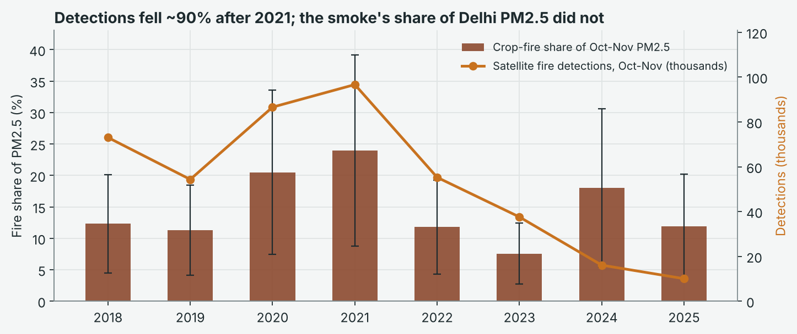
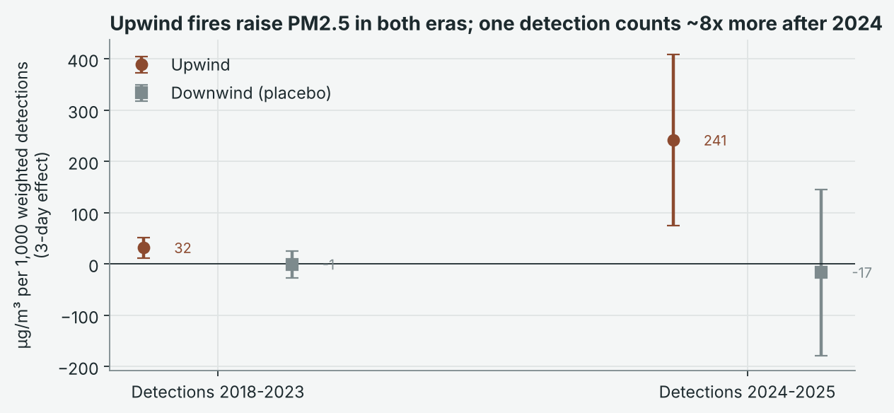
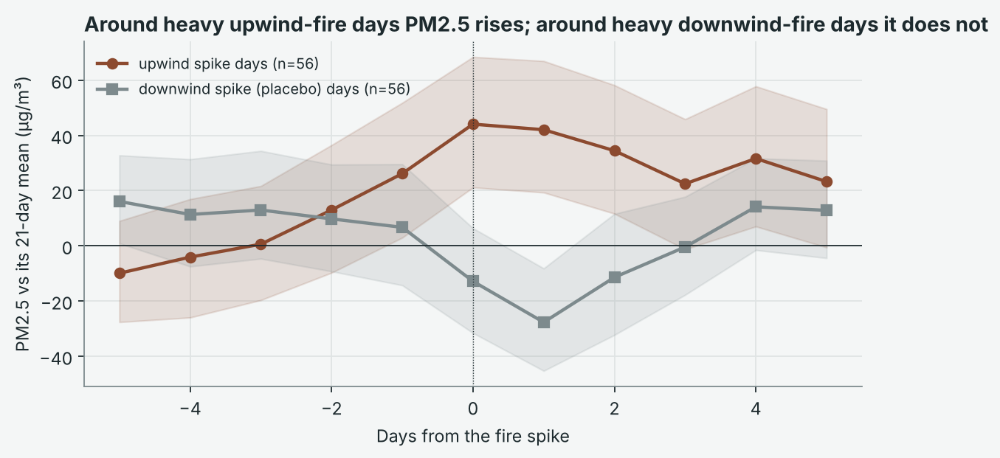

# Delhi Winter Smog

**How much of Delhi's October-November smog comes from crop fires and the weather, and would acting a month earlier have helped?**

Every winter Delhi's PM2.5 climbs to levels many times the safe limit. The cause is argued about every year. Some blame the farm fires in Punjab and Haryana, others blame the weather. This study uses eight seasons of measurements (2018-2025) to put a number on each, and tests every number before reporting it.

**[Interactive report](https://aishwaryasrivastav31.github.io/delhi-winter-smog/)** · **[Full write-up](REPORT.md)**

---

## Results at a glance

| | Finding |
|---|---|
| **Crop fires** | About **15%** of Delhi's October-November PM2.5 (95% CI 7.3-22.1%), or roughly 26 of 180 µg/m³ on an average day. |
| **Fewer fires on satellite** | Oct-Nov fire detections fell by about **90%** between 2021 and 2025. The smoke reaching Delhi did not fall: its share held at around 15%. |
| **Weather** | Within the same week, a still day carries about **52 µg/m³ (29%)** more PM2.5 than a windy one. |
| **GRAP a month earlier** | Starting the emergency plan on 1 September would lower PM2.5 by **3.4-3.7% at most**. |
| **Steady October cuts** | Cutting Delhi's own emissions by 30% in October gives about **10.8%** lower October PM2.5. Halving October crop fires gives about **6.5%**. |



*Satellite fire detections (line) fell by about 90% after 2021. The share of Delhi's PM2.5 coming from crop-fire smoke (bars, with 95% confidence intervals) did not.*

---

## The idea: let the wind decide

Fire-heavy days in Delhi are usually also cold, still and polluted for other reasons, so simply comparing smoky days with clear days says little. The study uses the wind instead.

On some days the wind blows from the burning fields towards Delhi. On other days the same fires burn while the wind carries their smoke away. If the fires really cause the pollution, only the first kind of day should be dirtier. That is what the data show:

- **Fires upwind** of Delhi raise PM2.5 clearly (p = 0.002 for 2018-2023, p = 0.005 for 2024-2025).
- **The same fires downwind** have no effect (the placebo share is -0.1%).
- **Shuffling the wind** 1,000 times reproduces the observed effect in only 2% of runs (p = 0.018).



Each fire is weighted by how directly that day's wind blows from it towards Delhi:

```
FireUp_d   = sum over fires of max(0,  cos(wind_d - bearing_fire)) / 1000
FireDown_d = sum over fires of max(0, -cos(wind_d - bearing_fire)) / 1000    (placebo)
```

Station-day PM2.5 (1,822 station-days over 485 days) is regressed on both, at lags 0-2. There is one fixed effect for each calendar week of each year, so every comparison is between days of the same week. Wind sector, temperature, humidity, rain, wind speed, weekday and station are controlled for. Standard errors are Driscoll-Kraay (14-day Bartlett), which allow for correlation across stations and over time.

Satellite fire detections changed character after 2023: there were far fewer of them, more were at night, and fire power was lower. The effect per detection is therefore estimated separately for 2018-2023 and 2024-2025.

---

## Tests

| Test | Purpose | Result |
|---|---|---|
| Downwind placebo | Smoke blowing away should not count | No effect |
| Permutation test (1,000 runs) | Could chance produce this? | p = 0.018 |
| Event study around fire spikes | Does PM2.5 jump on heavy upwind fire days? | +44 µg/m³ on the day; begins to climb the day before |
| Within-year dose-response | More upwind fire should mean more PM2.5 | Clear only in the top fifth of fire days (+38 µg/m³) |
| Station by station | Not driven by one monitor | 10-21% at each of the 4 stations |
| Second satellite (NOAA-20) | Not an artefact of one satellite | 13% vs 18% with S-NPP (2024-2025) |



Every estimate, including the alternatives that were tried, is saved as a CSV in `reports/tables/`.

---

## Data

| Source | Coverage | Size |
|---|---|---|
| CPCB CAAQMS, hourly | Anand Vihar, Ashok Vihar, Aya Nagar, Bawana; 2018-2025 | 280,512 hourly records |
| CPCB / DPCC, 15-minute | Anand Vihar, 2024-2025 | 70,177 records |
| NASA FIRMS VIIRS S-NPP | Punjab-Haryana, 2018-2025 | 742,861 fire detections |
| NASA FIRMS VIIRS NOAA-20 | Punjab-Haryana, 2024-2025 | 115,271 fire detections |
| NASA POWER (MERRA-2) | Central Delhi, daily, 2018-2025 | 2,922 days |

**Data quality.** During the project, the government repository was found to be serving one station's readings under other stations' names. The pipeline now checks every file and stops the run if any two stations match on more than 50% of shared hours. The largest match in the final data is 1.4%. A day is used only when at least 18 of its 24 hours are valid.

---

## Run it yourself

Requires Python 3.10 or newer.

```bash
git clone https://github.com/Aishwaryasrivastav31/delhi-winter-smog.git
cd delhi-winter-smog
pip install -r requirements.txt

python run_all.py            # every table, figure and result (about 40 seconds)
python src/report_html.py    # rebuild the interactive report
python -m pytest             # unit tests
```

Use `python run_all.py --quick` for a faster run with 100 permutations instead of 1,000.

---

## Repository structure

```
run_all.py               runs the full analysis in order
src/
  config.py              settings: paths, detection periods, permutation count
  data.py                loading, station integrity check, wind-weighted fire index
  models.py              fixed-effects OLS with Driscoll-Kraay standard errors
  fire_model.py          fire effects, attribution, permutation test, event study
  counterfactuals.py     GRAP a month earlier, October emission and fire cuts
  figures.py             the ten figures
  report_html.py         builds the interactive report
tests/
  test_core.py           unit tests
data/                    raw air-quality, fire and weather files; GRAP dates
reports/
  tables/                every number in the report, as CSV
  figures/               all figures
  report.html            interactive report
index.html               entry point for the GitHub Pages site
REPORT.md                full write-up
```

---

## Related work

This is the second study in a series. The first evaluated Delhi's Graded Response Action Plan (GRAP) Stage III/IV during 2024-2025. It found no statistically significant reduction in PM2.5. Its confidence range is used here to estimate what starting GRAP a month earlier could achieve.

## Sources

- Central Pollution Control Board, [CAAQMS Data Repository](https://airquality.cpcb.gov.in/ccr/)
- NASA, [FIRMS VIIRS 375 m active fire archive](https://firms.modaps.eosdis.nasa.gov/)
- NASA, [POWER daily point data](https://power.larc.nasa.gov/)
- TERI and ARAI (2018), *Source Apportionment of PM2.5 and PM10 of Delhi NCR*

## Author

**Aishwarya Srivastava**
[LinkedIn](https://www.linkedin.com/in/aishwarya-srivastav-5a63222b1/) · [GitHub](https://github.com/Aishwaryasrivastav31)
