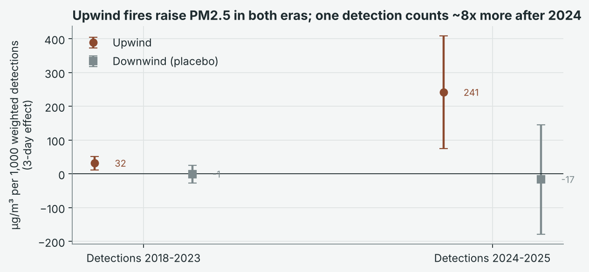
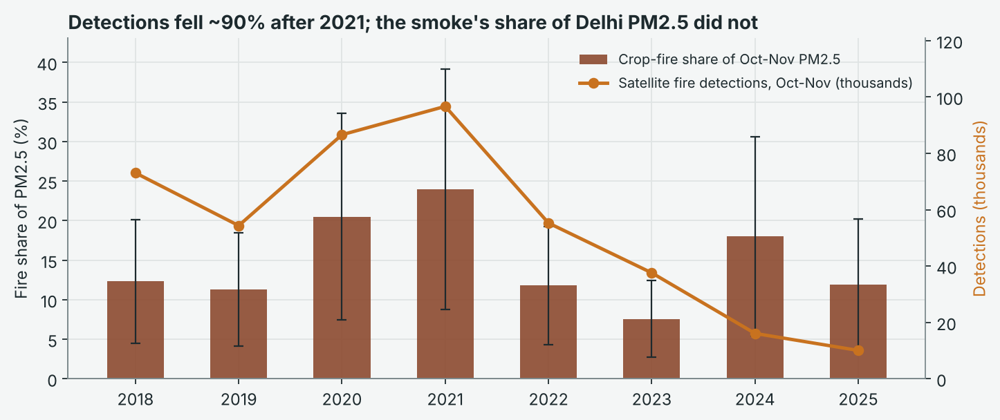
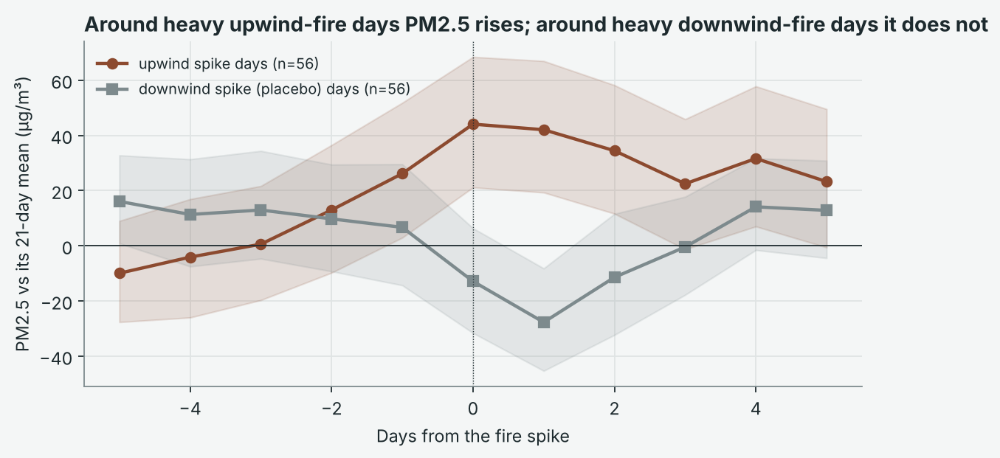
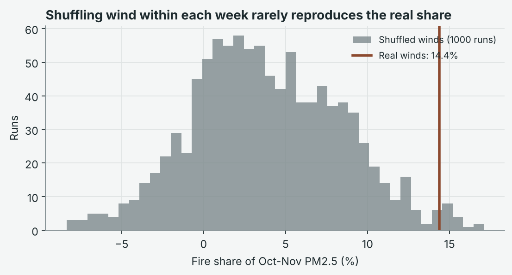
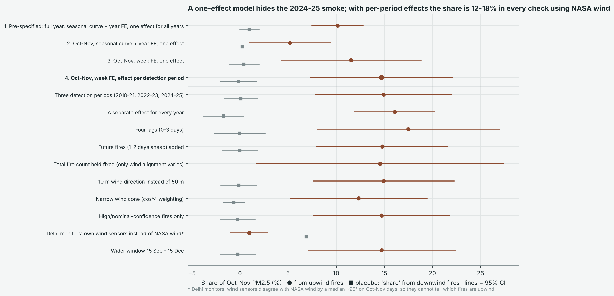
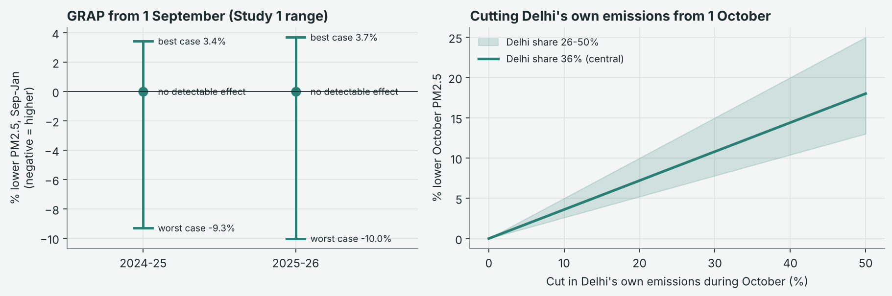

# Where Delhi's Winter Smog Comes From

**A wind-direction study of crop-fire smoke over eight burning seasons (2018-2025), and what acting a month earlier could achieve**

Aishwarya Srivastava

---

## Abstract

Delhi's PM2.5 in October and November averages about 180 µg/m³, three times India's 24-hour standard. Every year the blame shifts between crop-residue burning in Punjab and Haryana and the weather. This study estimates the contribution of crop fires using a natural experiment. On any given day, the wind decides whether the same fires blow towards Delhi or away from it.

The data are 280,512 hourly readings from four government monitors, 742,861 NASA VIIRS fire detections and daily NASA weather. Days are compared only with other days in the same calendar week. On this basis, crop fires account for **14.7% of Delhi's October-November PM2.5 (95% CI 7.3-22.1%)**, about 26 µg/m³. Fires downwind of the city explain nothing (placebo share -0.1%). Shuffling wind directions 1,000 times reproduces a share this large in 1.8% of runs.

Satellite detections fell by about 90% between 2021 and 2025, but the smoke's share did not. One detection now corresponds to roughly eight times more PM2.5 than before, which is consistent with burning moving outside the satellite's afternoon overpass.

Within a single week, the weather moves PM2.5 by 52 µg/m³. Enforcing the Graded Response Action Plan (GRAP) from 1 September would lower September-January PM2.5 by at most 3.4-3.7%. Sustained October cuts would achieve more: a 30% reduction in Delhi's own emissions would lower October PM2.5 by about 10.8%.

---

## Key results

| Question | Result |
|---|---|
| Share of Oct-Nov PM2.5 from Punjab-Haryana crop fires | **14.7%** (95% CI 7.3-22.1%), about 26 of 180 µg/m³ |
| Does the effect come from the fires, not the season? | Upwind fires raise PM2.5 (p = 0.002 and p = 0.005). Downwind fires do not (placebo share -0.1%). Permutation p = 0.018. |
| Did falling fire counts mean less smoke? | No. Detections fell ~90% (2021 to 2025). The smoke's share stayed at 14.6% (2018-23) and 15.1% (2024-25). |
| How much does weather matter? | 52 µg/m³ (29% of the season mean) between a ventilated and a stagnant day in the same week |
| GRAP from 1 September | At most 3.4-3.7% lower Sep-Jan PM2.5; no detectable effect at the central estimate |
| Sustained October cuts | Delhi's own emissions -30%: about -10.8% October PM2.5. October crop fires halved: about -6.5%. |

---

## 1. Background

### 1.1 The problem

Between 2018 and 2025, Delhi's PM2.5 averaged 123 µg/m³ in October and 238 µg/m³ in November, two to four times the national 24-hour standard of 60 µg/m³. The policy response depends on the diagnosis:

- if crop fires dominate, the answer lies in the fields of Punjab and Haryana;
- if local emissions dominate, it lies in Delhi's transport, industry and construction;
- if the weather dominates, the city can mainly prepare and protect people.

### 1.2 Earlier estimates

| Source | Method | Crop-fire share |
|---|---|---|
| SAFAR daily estimates, reported by Down To Earth (2021) | Forecast model | 0-58% on individual days |
| Down To Earth (2021) | Averaging daily shares over Oct-Nov | 13-17% of the season |
| Centre for Science and Environment (2022) | 81 stations with SAFAR fire data | About 28 µg/m³ a day; over 80% of daily PM2.5 from other sources |
| TERI-ARAI (2018) | Source apportionment | Delhi's own emissions 36% of winter PM2.5 |

Most published figures come from forecast models, whose assumptions are hard to check from outside. A study by ISRO's Space Applications Centre also reports that peak burning shifted from about 13:30 in 2020 to about 17:00 in 2024. That is after the overpass of the polar-orbiting satellites that most fire counts rely on.

### 1.3 Research questions

1. **RQ1.** How much of Delhi's October-November PM2.5 is caused by Punjab-Haryana crop fires, and how much does day-to-day weather move it?
2. **RQ2.** If action started about a month earlier, how much lower would PM2.5 be?

---

## 2. Data

| Source | Coverage | Size |
|---|---|---|
| CPCB CAAQMS, hourly | Anand Vihar, Ashok Vihar, Aya Nagar, Bawana; 2018-2025 | 280,512 hourly rows, 31 files |
| CPCB / DPCC, 15-minute | Anand Vihar, 2024-2025 | 70,177 rows |
| NASA FIRMS VIIRS S-NPP | Punjab-Haryana box (27.6-32.6°N, 73.8-77.6°E), 2018-2025 | 742,861 vegetation-fire detections |
| NASA FIRMS VIIRS NOAA-20 | Same box, 2024-2025 | 115,271 detections |
| NASA POWER (MERRA-2) | Central Delhi, daily, 2018-2025 | 2,922 days |
| Policy dates | GRAP Stage III orders | 2 seasons |

**Station-days.** A station-day is used only if at least 18 of its 24 hours are valid. Under that rule, 10,571 of 11,688 possible station-days (90%) are usable.

**Fire detections.** Detections are kept only if they are classified as vegetation fires, lie inside the Punjab-Haryana box, and are more than 40 km from central Delhi.

### 2.1 Data integrity

During the work, two stations that should differ were found to report identical readings hour after hour. The CPCB portal was serving Anand Vihar's data under other station names. The affected files were downloaded again.

The pipeline now compares every pair of stations hour by hour. It stops the run if any two stations are identical in more than 50% of their shared hours. In the final data the largest overlap is 1.4%.

---

## 3. Method

### 3.1 Identification: the wind decides

Burning peaks in late October and November. That is also when the air turns still and cold, and when local emissions rise. A comparison of smoky and clean periods would therefore attribute all of this to the fires.

The study instead uses day-to-day changes in wind direction, which the fires cannot control. Each detection *i* is weighted by how directly the day's 50 m wind (direction θ) blows from it towards Delhi, given the fire's bearing *b*:

```
FireUp_d   = (1/1000) * sum_i max(0,  cos(theta_d - b_i))
FireDown_d = (1/1000) * sum_i max(0, -cos(theta_d - b_i))
```

FireDown is a placebo. If smoke drives the result, upwind fires should raise PM2.5 and downwind fires should not. If both appear to raise it, something other than smoke is responsible.

### 3.2 Model

Station-day PM2.5 in October-November 2018-2025 is regressed on FireUp and FireDown at lags of 0, 1 and 2 days. The sample is 1,822 station-days over 485 days. The controls are:

- **One fixed effect per calendar week of each year.** Each day is compared only with days in the same week, which absorbs the seasonal build-up, the harvest calendar and any policy stage in force.
- **Weather and wind:** eight wind sectors, temperature, relative humidity, log rainfall, and wind speed at 10 m and 50 m.
- **Weekday and station** fixed effects.

Standard errors are Driscoll-Kraay with a 14-day Bartlett kernel. They allow for correlation across stations on the same day and across nearby days.

### 3.3 Detection periods

The effect per detection is estimated separately for 2018-2023 and 2024-2025, because detections changed character after 2023:

- the night-time share rose from 0.3-0.9% to about 4%;
- median fire radiative power fell from 4.5-5.1 MW to 3.8 MW;
- total detections fell by about 90%.

This choice was made after seeing the data. Every alternative, including the original single-effect model, is reported in Section 5.

### 3.4 From effects to a share

Daily fire PM2.5 is the sum of each estimated effect multiplied by that day's upwind index. The share is the season mean of fire PM2.5 divided by mean PM2.5. Confidence intervals use the delta method.

---

## 4. Results

### 4.1 Upwind fires raise PM2.5; downwind fires do not



| Period | Upwind, 3-day effect per 1,000 weighted detections | Downwind (placebo) |
|---|---|---|
| 2018-2023 | **+31.7 µg/m³** [11.5, 51.9], p = 0.002 | +0.5 [-26.1, 27.1], p = 0.97 |
| 2024-2025 | **+239.2 µg/m³** [72.0, 406.4], p = 0.005 | -14.2 [-178.1, 149.7], p = 0.87 |

Most of the effect arrives on the same day (lag 0: +24.6 µg/m³, p < 0.001 in 2018-2023). The difference between the two periods is significant (+207.5, p = 0.016).

### 4.2 Crop fires account for about 15% of the season

| Period | Mean PM2.5 (µg/m³) | From crop fires (µg/m³) | Share [95% CI] |
|---|---|---|---|
| **Oct-Nov 2018-2025** | 179.7 | 26.5 | **14.7%** [7.3, 22.1] |
| 2018-2023 | 174.7 | 25.5 | 14.6% [5.3, 23.9] |
| 2024-2025 | 194.6 | 29.4 | 15.1% [4.6, 25.7] |
| October | 123.0 | 16.1 | 13.1% [7.0, 19.1] |
| November | 237.6 | 37.1 | 15.6% [7.5, 23.7] |

The seasonal average hides large daily swings:

- on the median day, smoke is 8.5% of PM2.5;
- on the smokiest tenth of days it is 34% or more;
- it exceeded a quarter of PM2.5 on 87 of 485 days.

The result is close to the independent season-level estimates of 13-17% (Down To Earth) and about 28 µg/m³ a day (CSE).

### 4.3 Fewer detections, the same smoke



| | 2018 | 2019 | 2020 | 2021 | 2022 | 2023 | 2024 | 2025 |
|---|---|---|---|---|---|---|---|---|
| Detections, Oct-Nov | 73,045 | 54,334 | 86,601 | 96,664 | 55,254 | 37,572 | 16,074 | 10,033 |
| Fire share of PM2.5 | 12.3% | 11.3% | 20.5% | 23.9% | 11.8% | 7.6% | 18.0% | 11.9% |

Detections fell from 96,664 in 2021 to 10,033 in 2025, while the smoke's share did not fall. A model that assumes one effect per detection in every year would put the 2024-2025 share at about 2%, a large undercount.

The study cannot prove why detections changed. Its practical conclusion holds either way: a fall in satellite fire counts is not, by itself, evidence that less smoke is reaching Delhi.

### 4.4 Weather decides how much stays

Within the same week, the combined weather component moves PM2.5 by **52.3 µg/m³** from the 10th to the 90th percentile. The combined component covers wind sector, wind speed, humidity, temperature and rain. The swing is 29.1% of the season mean. No single weather variable is significant on its own; the effect comes from the combination.

### 4.5 The season in context

| Source | Share of Oct-Nov PM2.5 | Basis |
|---|---|---|
| Punjab-Haryana crop fires | 14.7% (7.3-22.1%) | Measured in this study |
| Delhi's own emissions | 36% (26-50%) | TERI-ARAI (2018), not measured here |
| NCR, regional sources, secondary aerosol | about 49% | Remainder |

---

## 5. Robustness

### 5.1 Tests that support the result



| Test | Question | Result |
|---|---|---|
| Downwind placebo | Do fires blowing away from Delhi also seem to raise PM2.5? | No: -0.1% (CI -2.0 to 1.9%) |
| Permutation test | How often does shuffled wind (within each week, 1,000 runs) produce a share this large? | 1.8% of runs (p = 0.018) |
| Total fires held fixed | With the fire count fixed, does wind alignment alone matter? | Yes: 14.4% (1.5-27.3%) |
| Event study | PM2.5 around the heaviest 10% of upwind vs downwind fire days | +44 µg/m³ on the day (CI 21-68) vs -13. PM2.5 already starts rising the day before. |
| Dose-response | Do heavier smoke days add more? | Clearly only in the heaviest fifth (+38.4 µg/m³, p = 0.029) |
| By station | Does it hold at each monitor? | 10.3-21.2%, above zero at all four |
| Second satellite | Does NOAA-20 agree (2024-2025)? | 13.0% vs 18.2% with S-NPP |
| Wheat season (April-May) | Does the method find smoke in the other burning season? | 4.6% [1.8, 7.3] |



### 5.2 Specification ladder



| Specification | Fire share [95% CI] | Placebo share |
|---|---|---|
| Pre-specified: full year, one effect | 10.4% [7.7, 13.2] (2024-25: 1.9%) | 1.2% |
| Oct-Nov, week fixed effects, one effect | 11.7% [4.4, 18.9] (2024-25: 2.1%) | 0.5% |
| **Primary: per-period effect** | **14.7% [7.3, 22.1]** | **-0.1%** |
| Three detection periods | 15.0% [7.9, 22.0] | 0.2% |
| A separate effect for every year | 16.2% [12.2, 20.2] | -1.7% |
| Four lags (0-3 days) | 17.1% [7.9, 26.4] | 0.1% |
| Future fires added | 14.8% [7.9, 21.6] | 0.0% |
| 10 m wind direction | 15.0% | 0.0% |
| Narrow wind cone (cos⁴) | 12.4% | -0.6% |
| High/nominal-confidence fires only | 14.7% | -0.2% |
| Wider window, 15 Sep-15 Dec | 14.7% | -0.2% |

Across every specification that uses regional wind and per-period effects, the share lies between 12% and 18%.

### 5.3 Tests that did not pass cleanly

- **Future fires, 2024-2025.** Fires detected one or two days ahead predict today's PM2.5 in 2024-2025 (+106.7, p < 0.001), but not in 2018-2023 (+10.6, p = 0.24). The most plausible reason is the same timing shift: burning missed by today's overpass is detected tomorrow. Adding future fires leaves the share at 14.8%.
- **Carbon monoxide.** CO does not rise with upwind fires (+0.06 mg/m³, p = 0.17). Delhi's CO is dominated by traffic and local combustion.
- **Monitor wind sensors.** Using the stations' own wind sensors gives almost no effect (1.0%). Those sensors differ from regional wind by a median of 95°, with only 20% of days within 45°. They cannot identify upwind fires, so this check is uninformative rather than contradictory.
- **Permutation baseline.** Shuffled shares average 3.9%, not zero, because shuffled winds still partly follow the weekly fire total. The real share (14.4%) is well above that baseline.

---

## 6. Acting a month earlier



| Lever | Effect | Basis |
|---|---|---|
| GRAP Stage III from 1 September (72-75 days earlier) | Best case -3.4% (2024-25) and -3.7% (2025-26) of Sep-Jan PM2.5. No detectable effect at the central estimate; worst case +9-10%. | Full confidence range from the GRAP evaluation (Study 1) |
| GRAP Stage III from 1 October | Best case -2.9% / -3.1% | As above |
| Delhi's own emissions -10 / -30 / -50% from 1 October | October PM2.5 -3.6 / -10.8 / -18.0% | TERI-ARAI local share (26-50%), scenario |
| October crop fires -25 / -50 / -100% | October PM2.5 -3.3 / -6.5 / -13.1% (CI for -50%: 3.5-9.6%) | Measured October fire share |

**Timing of severe days.** Only 10 of 106 severe days (above 250 µg/m³) in October-November 2018-2025 came before 1 November. October is still unhealthy every year, at 1.3-2.5 times the daily standard. Earlier action would mainly improve the long run of unhealthy October days, rather than prevent November's emergencies.

---

## 7. Limitations

- **Four monitors.** The stations span east, north and south Delhi, and the results agree across them, but other neighbourhoods may differ.
- **Delhi's own share is borrowed.** The 36% local share comes from TERI-ARAI (2018) and may have changed since. The local-cut scenarios inherit that uncertainty.
- **The per-period model was chosen after seeing the data.** It is motivated by the change in detections and by the ISRO timing study, and every alternative is reported.
- **Detections are a proxy.** The study measures the link between detected fires and Delhi's air, not burning directly.
- **Linearity.** Effects are assumed linear within each period, so period averages are more reliable than shares on single extreme days.
- **The GRAP counterfactual is borrowed.** It applies the earlier study's estimate rather than measuring GRAP afresh.
- **The second-satellite check covers 2024-2025 only.**

---

## 8. Conclusion

Over eight seasons, crop-fire smoke accounts for about 15% of Delhi's October-November PM2.5. The evidence that the relationship is causal is strong:

- upwind fires raise pollution and downwind fires do not;
- shuffled winds rarely reproduce the effect;
- the result holds at every monitor and across a wide range of specifications.

The share held steady even as satellite fire counts fell by 90%, so falling counts should not be read as falling smoke. Weather multiplies whatever is emitted.

Moving the emergency plan a month earlier would change little. Sustained emission cuts from October, in the city and in the fields, are what the evidence supports. Better measurement of burning, through night-time and geostationary observation, would make progress easier to track.

---

## Appendix A. Statistical tests

| Test | Statistic | Result | p-value |
|---|---|---|---|
| Upwind effect, 2018-2023 | Wald z | +31.7 per 1,000 detections | 0.002 |
| Upwind effect, 2024-2025 | Wald z | +239.2 | 0.005 |
| Downwind placebo, both periods | Wald z | +0.5; -14.2 | 0.97; 0.87 |
| Difference between periods | Wald z | +207.5 | 0.016 |
| Permutation (1,000 runs) | Share under shuffled wind | Real 14.4% vs shuffled mean 3.9% | 0.018 |
| Future-fire placebo | Wald z | 2018-23: +10.6; 2024-25: +106.7 | 0.24; < 0.001 |
| Heaviest dose fifth | Wald z | +38.4 µg/m³ | 0.029 |
| CO tracer, 2018-2023 | Wald z | +0.06 mg/m³ | 0.17 |

## Appendix B. Reproducibility

Every number in this report is produced by `python run_all.py` and saved as a CSV in `reports/tables/`. The figures are in `reports/figures/`, and an interactive version of the report is in `reports/report.html`.

| Section | Tables |
|---|---|
| Data and integrity | `00_file_audit`, `01_station_integrity`, `02_`, `03_detection_*` |
| Fire effects and share | `10_primary_effects`, `20_`, `21_`, `22_fire_contribution*` |
| Robustness | `11_specification_ladder`, `12_checks`, `12b_` to `19_` |
| Weather and composition | `30_`, `31_weather_*`, `32_oct_nov_composition` |
| Earlier action | `50_grap_earlier`, `51_`, `52_`, `53_*` |

## References

- Central Pollution Control Board, [CAAQMS Data Repository](https://airquality.cpcb.gov.in/ccr/).
- NASA, [FIRMS VIIRS 375 m active fire archive](https://firms.modaps.eosdis.nasa.gov/).
- NASA, [POWER daily point data](https://power.larc.nasa.gov/).
- TERI and ARAI (2018), *Source Apportionment of PM2.5 and PM10 of Delhi NCR*.
- Down To Earth (2021), [Delhi pollution crisis: the figure of 4-10% for stubble fires is not wrong but irrelevant](https://www.downtoearth.org.in/amp/story/air/delhi-pollution-crisis-the-figure-of-4-10-for-stubble-fires-is-not-wrong-but-irrelevant-80268).
- Down To Earth (2022), [Winter pollution: 80% of daily PM2.5 levels in Delhi-NCR from non-stubble sources](https://www.downtoearth.org.in/amp/story/pollution/winter-pollution-80-daily-pm2-5-levels-in-delhi-ncr-from-non-stubble-sources-82160).
- The Tribune, [Reduced farm fire claims misleading, farmers evading satellites: ISRO study](https://www.tribuneindia.com/news/india/reduced-farm-fire-claims-misleading-farmers-evading-satellites-isro-study/amp).
- Driscoll, J. C. and Kraay, A. C. (1998). Consistent covariance matrix estimation with spatially dependent panel data. *Review of Economics and Statistics*, 80(4), 549-560.
